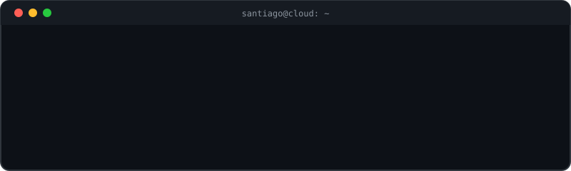

---

## About me

Hi, I'm **Santiago**, a Cloud/DevOps engineer based in Colombia 🇨🇴.
I design and automate AWS infrastructure for banking environments, and I use AI agents to automate operations.

- ☁️ **Cloud/DevOps Engineer at IBM**: multi-account AWS infrastructure for Bancolombia (CloudFormation, Terraform, Ansible Automation Platform, Azure DevOps).
- 💸 Cut AWS costs across 3 environments with scheduled on-demand start/stop automation.
- 🤖 Building AI agents with **LangGraph** and **Bedrock** that connect LLMs to APIs and infrastructure workflows.
- 🎓 AWS Certified: Solutions Architect Associate and Cloud Practitioner. Preparing Red Hat EX374.
- 🌎 Open to remote Cloud / DevOps / Platform Engineering roles.

## Stack

`LangGraph` · `Bedrock` · `RAG` · `CloudFormation` · `Django` · `Flask` · `MySQL`

## What I'm building

- 🔭 **[neuer-radar-ai](https://github.com/TU_USUARIO/neuer-radar-ai)**: an AI agent that curates news and matches articles to my interests.
- 🧪 Exploring multi-agent teams with local models (Ollama) and Claude via API.

## Contact

📫 LinkedIn: [TU_NOMBRE](TU_URL_DE_LINKEDIN) · ✉️ TU_CORREO
